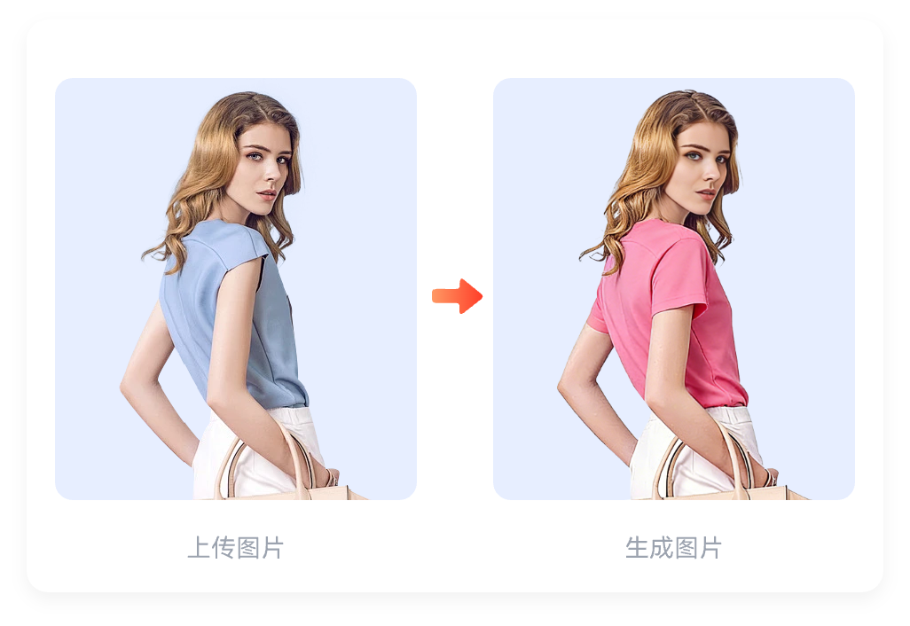

# 衣览无余

衣览无余是一个 AI 服装图片处理与检索项目。用户可以上传服装或人物图片，使用自然语言编辑、合并图片，并通过文字或图片检索自己的图片；系统还会保存操作历史，方便回看。

## 功能预览

以下为前端内置的功能演示素材，展示图片编辑和合并的目标效果。

| 图片编辑 | 图片合并 |
| --- | --- |
|  |  |

## 主要功能

- **账号登录**：支持用户名密码及邮箱验证码登录，使用 JWT 维护登录状态。
- **图片上传**：Java 服务接收图片，执行图片审核后上传到阿里云 OSS，并保存文件信息。
- **AI 图片编辑与合并**：输入自然语言指令，调用 Python 图片服务和阿里云百炼模型处理图片。
- **图片检索**：支持文字搜图和图片搜图；Python 服务结合图片描述文本相似度、CLIP 图像向量和 Redis 用户索引完成检索。
- **历史记录**：查看用户的图片编辑、合并等操作记录。

## 项目结构

```text
D:\AiWear
├── fronted/       # Vue 3 + Vite 前端
├── AiWear_b/      # Spring Boot Java 后端
└── pythonFlask/   # Flask 图片处理与检索服务
```

## 技术架构

```text
浏览器（Vue 3，5173）
        │ /api 请求
        ▼
Java 服务（Spring Boot，8081） ─── MySQL：用户、文件和历史记录
        │                         ├── Redis：验证码、缓存和图片检索索引
        ├── 阿里云 OSS：图片存储
        ▼
Python 服务（Flask，5000） ────── 阿里云百炼：图片理解与生成
        └──────────────────────── 本地 CLIP 模型：图像向量提取
```

| 模块 | 主要技术 | 目录 |
| --- | --- | --- |
| 前端 | Vue 3、Vite、Vue Router、Pinia、Axios、Element Plus | [`fronted/`](fronted/) |
| Java 后端 | Java 17、Spring Boot 3.5、MyBatis-Plus、MySQL、Redis、阿里云 OSS | [`AiWear_b/`](AiWear_b/) |
| AI 图片服务 | Python、Flask、LangChain、DashScope、Transformers、CLIP、Redis | [`pythonFlask/`](pythonFlask/) |

## 本地运行

### 运行前准备

- Java 17 和 Maven
- Node.js 与 npm
- Python（能够安装 [`pythonFlask/requirements.txt`](pythonFlask/requirements.txt) 中的依赖）
- MySQL、Redis、阿里云 OSS Bucket、阿里云百炼 API Key
- 本地 CLIP `clip-vit-base-patch16` 模型文件

先启动并配置 MySQL、Redis。Java 服务通过 `AiWear_b/src/main/resources/application.yml` 读取数据库、Redis、邮件、JWT、OSS 和 Python 服务配置；Python 服务通过 `pythonFlask/.env` 读取百炼、Redis 和 CLIP 模型配置。请按本机环境填写这些文件，**不要把真实密码、密钥或令牌提交到 Git**。

Python 服务默认连接本机 Redis `127.0.0.1:16379`，并监听 `5000` 端口。Java 服务当前监听 `8081` 端口。前端开发服务器监听 `5173`，开发代理目标通过 `fronted/.env.development` 中的 `PROXY_TARGET` 配置；例如：

```dotenv
PROXY_TARGET=http://127.0.0.1:8081
```

### 启动 Python 图片服务

```powershell
cd D:\AiWear\pythonFlask
python -m venv .venv
.\.venv\Scripts\Activate.ps1
python -m pip install -r requirements.txt
python server.py
```

若虚拟环境和依赖已经准备好，直接激活 `.venv` 并运行 `python server.py` 即可。首次运行前请确认 `.env` 中的百炼配置、Redis 地址和 `CLIP_MODEL_PATH` 均有效。

### 启动 Java 后端

```powershell
cd D:\AiWear\AiWear_b
mvn spring-boot:run
```

请确认 `application.yml` 中的数据库、Redis、OSS、邮件、JWT 以及 Python 服务地址已经配置。账号验证码发送依赖邮件配置；图片相关功能依赖 Python 服务、百炼和 OSS。

### 启动前端

```powershell
cd D:\AiWear\fronted
npm install
npm run dev
```

打开 [http://localhost:5173](http://localhost:5173)。前端通过 Vite 将 `/api` 请求代理至 `PROXY_TARGET` 指定的 Java 服务。

## 常用命令

```powershell
# 前端生产构建（在 fronted 目录执行）
npm run build

# Java 测试（在 AiWear_b 目录执行）
mvn test
```

## 主要接口

| 服务 | 接口 | 用途 |
| --- | --- | --- |
| Java | `POST /api/user/auth`、`POST /api/user/send-code`、`POST /api/user/logout` | 登录、发送验证码和登出 |
| Java | `POST /api/file/upload/image`、`GET /api/file/my-images` | 上传图片和查看个人图片 |
| Java | `POST /api/file/edit`、`POST /api/file/merge`、`POST /api/file/search` | 图片编辑、合并和检索 |
| Java | `GET /api/record/my` | 查看个人历史记录 |
| Python | `POST /api/validate-image`、`POST /api/upload-image`、`POST /api/search-image` | 图片审核、建立图片检索索引和检索 |
| Python | `POST /api/skill/image`、`POST /api/skill-image` | 图片编辑/合并处理入口 |

除登录和验证码接口外，业务接口通常需要在请求头中携带 `Authorization: Bearer <token>`。图片编辑和生成需要调用远端模型，处理耗时会受网络和模型服务状态影响。

## 配置与安全

- `AiWear_b/src/main/resources/application.yml`、`pythonFlask/.env` 和 `fronted/.env.development` 用于本机配置，不应写入公开仓库。
- 不要将 OSS AccessKey、百炼 API Key、JWT 密钥、邮箱密码、数据库密码或测试账号密码放入 README、截图或提交记录。
- 使用个人 OSS Bucket、数据库和模型服务时，请确认对应账号已开通权限并配置正确的地域、访问地址和额度。
